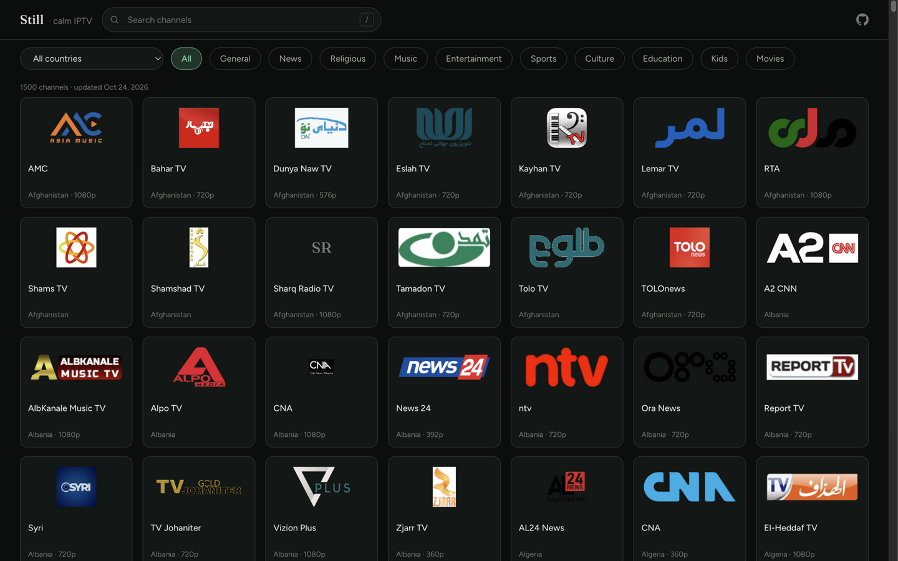

# Still · calm IPTV

A calm, fast, open-source IPTV player. Browse ~1,500 live channels from 179 countries and watch them in the browser — no accounts, no clutter, no shouting.

> **Live site:** [vpul.github.io/iptv-player](https://vpul.github.io/iptv-player/)

## Screenshots

| Browse | Watch |
|---|---|
|  |  |

## What it is

Most IPTV frontends are walls of thousands of stale links. Still takes a different approach:

- **Fresh by construction.** The channel list is curated from the continuously-updated [iptv-org](https://github.com/iptv-org/iptv) database. A [weekly GitHub Action](.github/workflows/refresh-channels.yml) re-curates the list, so dead links are pruned and new streams appear without any manual work.
- **Browser-playable only.** The curation script keeps HTTPS HLS (`.m3u8`) streams that work in a plain browser and drops anything needing custom headers.
- **Quiet by design.** Dark, low-contrast surfaces; one sage accent; typography that gets out of the way. The grid loads instantly and scrolls through every channel without breaking a sweat (virtualized rendering).

## Tech stack

| Concern | Choice |
|---|---|
| Build | [Vite 7](https://vite.dev/) |
| UI | [React 19](https://react.dev/) + TypeScript (strict) |
| Styling | [Tailwind CSS v4](https://tailwindcss.com/) (CSS-first `@theme` tokens) |
| Routing | [react-router v7](https://reactrouter.com/) |
| Playback | [hls.js](https://github.com/video-dev/hls.js/) (native HLS on Safari) |
| Virtualization | [@tanstack/react-virtual](https://tanstack.com/virtual) |
| Data | [iptv-org API](https://iptv-org.github.io/api/) → curated `public/channels.json` |

## Getting started

```bash
npm install
npm run dev        # http://localhost:5173/iptv-player/
```

Other scripts:

```bash
npm run build            # typecheck + production build
npm run typecheck        # strict TS, no emit
npm run update:channels  # re-curate the channel snapshot from the iptv-org API
```

## How the channel list stays fresh

`npm run update:channels` runs [`scripts/update-channels.mjs`](scripts/update-channels.mjs), which:

1. Pulls `streams.json`, `channels.json`, and `logos.json` from the iptv-org API (~11 MB).
2. Joins streams to channel metadata, keeping only browser-playable candidates: HTTPS HLS playlists that need no custom `User-Agent` or `Referrer`.
3. Drops NSFW and closed channels, picks the best-quality main feed per channel, and prefers in-use logos.
4. Balances the list across countries (per-country cap, total cap ~1,500) and writes a lean `public/channels.json` (~370 KB).

A GitHub Action re-runs this every Monday and commits the result, which triggers an automatic redeploy.

## Project layout

```
scripts/update-channels.mjs   channel curation pipeline
public/channels.json          generated snapshot (do not hand-edit)
src/styles/tokens.css         design tokens (Tailwind v4 @theme)
src/lib/                      data access (api client + useChannels hook)
src/pages/Home.tsx            search + filters + virtualized channel grid
src/pages/Watch.tsx           hls.js player + related channels
src/components/home/          header, search, filter bar, grid, cards, states
src/components/player/        video surface + stream error states
docs/screenshots/             images used in this README
```

Design context lives in [`PRODUCT.md`](PRODUCT.md) and [`DESIGN.md`](DESIGN.md).

## Credits & license

- Channel data: [iptv-org/iptv](https://github.com/iptv-org/iptv) and its contributors. Streams are hosted by the respective broadcasters; availability depends on each one.
- This app only indexes publicly available streams and hosts no video.
- Code: MIT — see [LICENSE](LICENSE).
